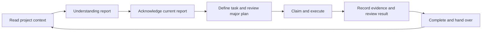

# UADOS v1.0

Universal Agentic Development Operating System: an executable, agent-independent framework for software, scientific research and hybrid projects. Project knowledge remains in the workspace when the human or AI contributor changes.

This repository extends the working **Part 1** implementation with **Phase 2** runtime protocols, dynamic role planning, staged adversarial consensus, change management and research innovation records. It contains a Python CLI, transactional project ledger, workflow gates, durable memory, independent review protocol, research runner, templates, agent prompts, working examples and CI configuration. Runtime dependencies: **Python 3.9+ standard library only**.

## Use it now

From this checkout, installation is optional:

```sh
python3 scripts/uados.py --help
python3 scripts/uados.py status
python3 scripts/uados.py audit
python3 scripts/uados.py init /path/to/new-project --name "My project" --objective "Describe the intended outcome" --mode auto
```

For an installed `uados` command, use a virtual environment:

```sh
python3 -m venv .venv
.venv/bin/python -m pip install .
.venv/bin/uados --help
```

On Windows, the corresponding interpreter and command are under `.venv/Scripts/`. Build tooling may be installed by pip; the runtime requires no third-party libraries, API keys or network service.

For an existing repository, add `--adopt` to initialization. It preserves existing maintained files, reports them for integration, and refuses collisions with generated state. Inspect and integrate existing README/AGENTS instructions.

## What is executable

| Capability | Runtime behavior |
| --- | --- |
| Context before action | Understanding Report, exact report-hash acknowledgement and stale-context rejection |
| Project memory | Transactional state/event history, readable Markdown and JSON, decisions, lessons and failures |
| Task management | Dependencies, ownership leases, declared scope overlap checks, explained work and validation evidence |
| Independent review | Major-task plan/result approvals; protocol-2 major work also requires staged debate with at least two independent reviewers |
| Planning and change control | Evidence-backed task plans and seven-field major change requests with alternatives |
| Dynamic orchestration | Capability declarations, generated role coverage, transparent assignments and provider-neutral dispatch packets |
| Adversarial consensus | Independent analysis, challenge, vote and evidence-bound consensus, preserving dissent |
| Approval relevance | Scoped code, policy and evidence fingerprints invalidate stale approvals |
| Research | Explicit argv execution, input/config/code hashes, seed/runtime metadata, captured output, timeout and recovery |
| Research innovation | Source access/coverage, seven-field ideas, separate falsifiable hypotheses and independent provisional novelty verdicts |
| Improvement | Read-only audit with explicit deduplicated proposed-improvement recording; fixes require owned reviewed work |
| Interpretation | Scientific conclusions and analysis evidence are recorded separately from process success |
| Handover | Completed work, design rationale, failures, blockers and actionable next steps survive agent changes |
| Recovery | Projection repair, portable export and validated reconstruction of a missing ledger after Git clone |



`--project ROOT` precedes the command. Tracked actions take `--session SESSION_ID`. See [the master workflow](MASTER_AGENT_WORKFLOW.md) for commands and [worked examples](EXAMPLES/README.md) for complete workflows. Use `context --full` to retrieve the governed documents for an agent adapter.

## Verify and explore

```sh
python3 -m unittest discover -s tests -v
python3 scripts/verify_scaffold.py
python3 scripts/run_examples.py --output /path/to/new-example-directory
```

The checked-in [software](EXAMPLES/generated/software/PROJECT_STATE.md), [research](EXAMPLES/generated/research/RESEARCH_MANAGEMENT/experiments.md) and [hybrid](EXAMPLES/generated/hybrid/PROJECT_STATE.md) examples are initialized projects with real fixture execution and handover history. Their contributor labels are scripted demonstrations; the actual separate-agent implementation review is recorded in [the independent audit](AUDIT/independent-review.md).

Read [architecture](docs/architecture.md), [requirements and acceptance scenarios](docs/requirements.md), [the storage ADR](docs/adr/0001-local-ledger.md) and [the Phase 2 ADR](docs/adr/0002-phase2-governance.md). The repository itself is initialized with UADOS: its live work, decisions and handover are in the same files used by downstream projects.

## Operating limits

Version 1 targets trusted collaborators sharing a local workspace. CLI gates cannot prevent direct editor writes, prove comprehension, authenticate agent identities, or authenticate a rewritten hash chain. Declared scope must cover the relevant implementation. Experiments preserve provenance and evidence; seed application, external data/environment restoration and scientific validity remain contributor responsibilities.

The CI matrix is configured for Linux, macOS and Windows on Python 3.9, 3.12 and 3.14. Phase 1 validation and platform limits are recorded in `AUDIT/validation.json`; Phase 2 results are recorded separately in its new final report; configured CI is not evidence that hosted CI has run. No remote repository, service or deployment is provisioned.

## Project workspace guide

UADOS keeps a project's decisions, tasks, evidence and handovers inside the project so another human or agent can continue the work. This scaffold supports software, research and hybrid projects. The Python CLI records structured work; the maintained documents explain how the team should carry it out.

Start with `MASTER_AGENT_WORKFLOW.md`, `PROJECT_STATE.md`, `SESSION_HANDOVER.md`, `DEVELOPMENT_LOG.md`, `DECISION_RECORD.md` and `PROJECT_MEMORY/`. Then read the rules for the work you plan to perform.

## Two kinds of project files

The authoritative record is `.uados/ledger.sqlite3`. UADOS commits current state and its hash-chained event together in one SQLite transaction. It generates these readable projections from that record:

- `PROJECT_STATE.md`: objective, mode, phase, work and blockers.
- `DEVELOPMENT_LOG.md`: durable action history.
- `DECISION_RECORD.md`: problems, alternatives, decisions and reasons.
- `SESSION_HANDOVER.md`: the latest recorded stopping point and next actions.
- `PROJECT_MEMORY/tasks.md`, `PROJECT_MEMORY/knowledge.md` and `RESEARCH_MANAGEMENT/experiments.md`: structured tasks, recorded notes and experiment records.
- `PROJECT_MEMORY/session_reports/`: issued Understanding Reports.
- `.uados/state.json` and `.uados/events.jsonl`: machine-readable projections.
- `CONSENSUS_DECISION.md`, `MULTI_AGENT_SYSTEM/role_plans.md` and `CHANGE_REQUESTS/CR*.md` records: role, debate and change views. The maintained `CR_TEMPLATE.md` is the exception.
- `RESEARCH_MANAGEMENT/LITERATURE_GAP_ANALYSIS.md`, `NOVELTY_AUDIT.md`, `RESEARCH_DECISION_RECORD.md` and `HYPOTHESES.md`: research evidence and provisional novelty views.
- `SYSTEM_IMPROVEMENT_LOG.md`: proposed audit improvements and their recorded disposition.

Do not edit those generated files manually. Use the CLI to change their source record. Write free-form knowledge in `PROJECT_MEMORY/notes/` or maintained policies, and link evidence through tracked actions. `audit --repair` rebuilds projections; it does not repair a damaged ledger or recover missing evidence.

## Navigation

| Location | Purpose |
| --- | --- |
| `MASTER_AGENT_WORKFLOW.md` | Single lifecycle authority |
| `.agent/` | Startup, task, memory, handover and compatibility guidance |
| `CHANGE_REQUESTS/` | Structured major changes and maintained worksheet |
| `PROJECT_MEMORY/` | Architecture, tasks, durable notes and lessons |
| `ENGINEERING_RULES/` | Software, quality, security and extension policies |
| `MULTI_AGENT_SYSTEM/` | Roles and independent adversarial review |
| `RESEARCH_MANAGEMENT/` | Hypotheses, experiment records, data and publication |
| `VERSION_CONTROL/` | Git, evidence retention and optional CI/release practices |
| `AUDIT/` | Consistency checks and recovery |
| `TEMPLATES/` | Reusable task, ADR, review and research records |
| `PROMPTS/` | Agent entry and execution instructions |
| `EXAMPLES/` | Worked workflows with expected outcomes |

## Start a session

Run from an environment with UADOS installed, replacing `AGENT_ID` with the team's stable label for the current contributor:

```sh
python -m uados --project . session start --agent AGENT_ID
```

Read the Understanding Report, verify it against the project files, and acknowledge the session using the session ID and report hash printed by the CLI:

```sh
python -m uados --project . session acknowledge SESSION_ID --report-hash REPORT_HASH
python -m uados --project . status
python -m uados --project . context
```

Pass `--session SESSION_ID` to tracked work commands. If another contributor changes recorded work or maintained context, refresh the session, read the replacement report and acknowledge its new hash before proceeding.

UADOS operates in a trusted local workspace. It checks its own tracked commands, but cannot prevent an editor from changing a file or prove that an agent read a document. Agent labels support ownership and distinct-reviewer checks; they do not authenticate people or models. External authentication, protected branches, secret storage, CI and deployment are team integrations, not services provided by this scaffold.

## Adoption and portability

For an existing repository, initialize with `init PATH --name ... --objective ... --mode ... --adopt`. Adoption preserves colliding maintained files such as an existing README or AGENTS instructions and reports `preserved_files`; inspect and integrate their content with this workflow. Existing generated-state collisions remain an error. Initialization without adoption refuses collisions, and neither form silently replaces maintained instructions.

`export PATH` creates an initialized portable directory at a new destination outside the project. It includes the ledger, maintained/generated memory and recorded scopes, evidence and experiment inputs/outputs. Repeat `--include PATH` for additional project-relative dependencies. Inspect privacy-sensitive content before sharing; installed environments and external resources may need separate restoration.

After a Git clone that contains consistent `.uados/events.jsonl` and `.uados/state.json` but no local database, use `python -m uados --project . rebuild-ledger`, then audit. Reconstruction validates exported history and only creates a missing database. It does not overwrite a current ledger or authenticate the exported record. See `VERSION_CONTROL/README.md` for what must be versioned together.

## Project mode

Initialization with `--mode auto` looks for software signals such as source files or package manifests, and research signals such as notebooks, bibliography/LaTeX files or experiment/dataset directories. Both signals select hybrid; research alone selects research; software or an empty project selects software. The empty-project choice has low confidence. Inspect the recorded detection evidence in `PROJECT_STATE.md`; explicitly choose `--mode software`, `--mode research` or `--mode hybrid` during initialization when the heuristic does not reflect the intended workflow. Detection is a starting classification, not a scientific assessment or automatic reclassification after every edit.


## Phase 2 operation and compatibility

Fresh projects use workflow protocol 2. Existing projects upgrade explicitly; ledger schema/history and legacy task gates remain intact. Protocol-2 tasks require recorded implementation and validation plans with evidence before claim. Major work adds change control, generated role coverage and staged plan/result debate alongside independent approvals. Consult the master workflow and operation-specific CLI help for the structured inputs; do not reuse a legacy approval as protocol-2 consensus.

The common client contract is [AGENTS.md](AGENTS.md), [CLAUDE.md](CLAUDE.md) and [Cursor's always-applied rule](.cursor/rules/uados.mdc), each pointing to the central master. [Compatibility details](.agent/compatibility.md) distinguish documented native loader behavior from tested local behavior. Cursor's requested plain `.md` reference is supplied alongside the `.mdc` file its loader recognizes. Qoder and ZCode use root AGENTS instructions; automatic file imports are not assumed. The host performs actual independent model dispatch; UADOS supplies agent-neutral packets and records.

Phase 2 acceptance artifacts are `AUDIT/scenario_test_report.md`, `AUDIT/phase2-final-report.md` and `AUDIT/self_review.md` when the validation run has produced them. The scenario runner uses local CLI execution and logical day labels for agent switching; it does not prove real commercial-client invocation or 30 elapsed days. Historical examples/evidence remain protocol-1 snapshots and are not rewritten to imitate Phase 2 compliance.

Remaining integration work includes authenticated contributor identity, real provider/native-client dispatch tests, external evidence anchoring, distributed coordination, larger-history performance, hosted cross-platform validation and domain-specific research search/design checks. Novelty verdicts are provisional evidence assessments rather than publication guarantees.


For a routine protocol-2 task, prepare a readable `evidence/plan.md`, then use the IDs printed by each operation:

```sh
python -m uados --project /path/to/new-project session start --agent Builder --runtime Codex
python -m uados --project /path/to/new-project session acknowledge SESSION_ID --report-hash REPORT_HASH
python -m uados --project /path/to/new-project task add --session SESSION_ID --title "Observable outcome" --description "Acceptance criteria" --risk routine --scope src/component
python -m uados --project /path/to/new-project task plan TASK_ID --session SESSION_ID --implementation "Steps and recovery" --validation "Checks and expected outcomes" --evidence evidence/plan.md
python -m uados --project /path/to/new-project task claim TASK_ID --session SESSION_ID
```

Implement the owned scope, execute meaningful checks and preserve their output. Refresh/acknowledge if governed context changed. Submit `task record TASK_ID --session SESSION_ID --summary ... --evidence evidence/validation.md`, audit, then `task complete TASK_ID --session SESSION_ID` and close the session with actual status/next steps. Major work uses the master's additional change/role/debate stages before claim and completion.

Run the complete Phase 2 local scenarios from this repository with:

```sh
python3 scripts/run_phase2_scenarios.py --output /path/to/new-phase2-scenario-directory
```

The output destination must be new. Read the emitted scenario evidence and its limits; a script's artificial reviewer labels exercise gates without proving real model independence. Separate model reviews of this implementation are recorded in the Phase 2 audit evidence.
