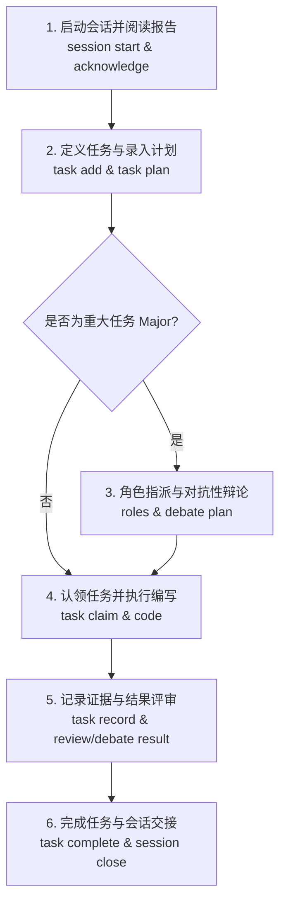

# UADOS 用户全流程指南：如何仅使用 UADOS 管理与推进项目

**UADOS (Universal Agentic Development Operating System)** 是一个完全可独立执行、不依赖特定大模型平台或私有 SaaS 编排工具的**通用智能体开发与操作操作系统**。

它仅依靠 **Python 3.9+ 标准库**，通过内置的事务性 SQLite 账本、哈希事件链和严格的工作流状态机，为软件工程、科学研究及混合项目提供全生命周期的上下文记忆、任务租约、多角色对抗性辩论、独立同行评审、实验可复现性以及跨会话无缝交接。

本指南专为希望**完全脱离第三方框架，仅通过原生 `uados` CLI 命令完成全流程项目研发与科学实验**的开发者和研究人员编写。

> 🇬🇧 **English documentation**: See [README_EN.md](README_EN.md) (The original English specification & quickstart).

---

## 目录

- [1. 为什么“只用 UADOS”？](#1-为什么只用-uados)
- [2. 环境准备与快速启动](#2-环境准备与快速启动)
- [3. 核心机制：六步闭环工作流](#3-核心机制六步闭环工作流)
- [4. 实战场景 A：常规软件研发全流程（Routine Task）](#4-实战场景-a常规软件研发全流程routine-task)
- [5. 实战场景 B：重大架构变更与多角色辩论（Major Task）](#5-实战场景-b重大架构变更与多角色辩论major-task)
- [6. 实战场景 C：科学研究与假设实验（Research Workflow）](#6-实战场景-c科学研究与假设实验research-workflow)
- [7. 实战场景 D：知识沉淀、系统审计与自进化](#7-实战场景-d知识沉淀系统审计与自进化)
- [8. 关键规则与双层文件架构](#8-关键规则与双层文件架构)
- [9. 完整 CLI 速查手册 (Cheat Sheet)](#9-完整-cli-速查手册-cheat-sheet)
- [10. 常见问题与避坑指南 (FAQ)](#10-常见问题与避坑指南-faq)

---

## 1. 为什么“只用 UADOS”？

很多团队在尝试利用 AI 智能体或多协作者进行长期项目开发时，常遇到三大痛点：
1. **上下文遗忘**：新会话或换人后，无法获知前序进展与历史决断。
2. **缺乏状态机约束**：AI 容易直接上手乱改代码，缺少先审后写、测试验证与代码范围约束。
3. **平台锁定**：强依赖某些商业云服务或重量级 Python 框架，安装配置繁重，无法在断网/离线环境下运行。

**UADOS 提供了终极纯净解法**：
- **零外部依赖**：仅需 Python 3.9+ 原生环境，不需要 `pip install` 任何第三方包，无网络调用。
- **事务性账本**：所有状态变更均以 ACID 事务提交于 `.uados/ledger.sqlite3`，具备 SHA256 哈希事件链防篡改审计。
- **自动投影视图**：自动同步生成 `PROJECT_STATE.md`、`DEVELOPMENT_LOG.md`、`SESSION_HANDOVER.md` 等人类/Agent 极易阅读的 Markdown 状态视图。
- **状态机门禁**：未经理解报告确认不可动工、未经计划批准不可认领、重大改动必须有多角色对抗性辩论投票。

---

## 2. 环境准备与快速启动

### 2.1 运行方式选择

你可以直接使用源码中的脚本，也可以通过标准 pip 本地安装命令：

#### 方式一：直接运行脚本（无需安装，即下即用）
```bash
python3 scripts/uados.py --help
```

#### 方式二：在虚拟环境中安装 CLI（推荐）
```bash
python3 -m venv .venv
source .venv/bin/activate       # Windows 用户运行: .venv\Scripts\activate
pip install .
uados --help
```

> **提示**：后文示例中均以 `python3 scripts/uados.py` 或安装后的 `uados` 为例。在多项目环境下，可通过 `--project /path/to/project` 指定工作区根目录（默认当前目录 `.`）。

### 2.2 项目初始化

#### 初始化一个全新的工程
```bash
# 模式支持: software (软件), research (科研), hybrid (混合), auto (自动识别)
python3 scripts/uados.py init /path/to/my-project \
  --name "AI-Analytics-Engine" \
  --objective "构建一套基于因果推断的高效时序数据分析引擎" \
  --mode software \
  --protocol-version 2
```

#### 接管既有项目（Adoption）
如果你已有既有 Git 仓库，只需添加 `--adopt` 参数，UADOS 会保留现有代码与说明文件，并生成基础治理脚手架：
```bash
cd /path/to/existing-repo
python3 /path/to/scripts/uados.py init . \
  --name "Legacy-Project" \
  --objective "重构核心模块并建立规范" \
  --adopt
```

### 2.3 查看状态与审计
随时随地检查当前工作区一致性：
```bash
# 检查账本与视图是否有漂移
python3 scripts/uados.py status

# 执行完整性审计（验证账本、事件链与证据文件）
python3 scripts/uados.py audit
```

---

## 3. 核心机制：六步闭环工作流



---

## 4. 实战场景 A：常规软件研发全流程（Routine Task）

本场景演示如何只用 UADOS 完成一个常规功能特性（如：增加时序平滑处理函数）。

### 第一步：开启会话并确认上下文（Context Before Action）

UADOS 强制要求“行动前必先建立上下文”。

```bash
# 1. 启动会话，指定你的标识（人名或 Agent 标识）
python3 scripts/uados.py session start --agent dev-alice
```
命令输出示例：
```json
{
  "session_id": "ses_01J7K8...",
  "report_path": "PROJECT_MEMORY/session_reports/ses_01J7K8...md",
  "report_hash": "a1b2c3d4e5f6...",
  "acknowledged": false
}
```

此时打开 `PROJECT_MEMORY/session_reports/ses_01J7K8...md`（即 **项目理解报告 Project Understanding Report**），查看当前工程目标、已完成进展、已知风险和下一步建议。

```bash
# 2. 确认理解报告（必须传入精确的 report-hash）
python3 scripts/uados.py session acknowledge ses_01J7K8... --report-hash a1b2c3d4e5f6...
```
*注：如果其他协作者在中途修改了状态，导致上下文陈旧，系统会拒绝操作。此时只需执行 `session refresh ses_...` 获取最新 hash 并重新 acknowledge 即可。*

---

### 第二步：添加任务并录入实现与验证计划

在写代码之前，先定义任务、划定影响范围（Scope）并制定验证计划。

```bash
# 1. 创建任务 (指定风险级别为 routine，限定影响作用域)
python3 scripts/uados.py task add --session ses_01J7K8... \
  --title "实现指数移动平均平滑算法" \
  --description "在 src/preprocess/smooth.py 中提供 EMA 平滑函数，并通过单元测试" \
  --risk routine \
  --scope src/preprocess/smooth.py \
  --scope tests/test_smooth.py
```
系统会返回任务 ID，例如 `task_01J7...`。

```bash
# 2. 准备实施与验证计划文档
mkdir -p evidence
cat << 'EOF' > evidence/plan_ema.md
# EMA 算法实施计划
1. 在 src/preprocess/smooth.py 中实现 `exponential_moving_average` 函数，支持 alpha 参数校验。
2. 边界处理：空数组、NaN 处理及单点输入。
3. 验证方案：在 tests/test_smooth.py 编写针对边界值与已知算例的单测，执行 pytest/unittest 确保 100% 覆盖。
EOF

# 3. 提交任务计划到账本
python3 scripts/uados.py task plan task_01J7... --session ses_01J7K8... \
  --implementation "编写 EMA 函数与入参合法性断言" \
  --validation "运行单元测试，比对预设基准输出" \
  --evidence evidence/plan_ema.md
```

---

### 第三步：认领任务租约（Task Claim）

拥有批准计划后，方可认领租约。租约机制可确保同一路径范围（Scope）不会被多个会话同时冲突篡改：

```bash
python3 scripts/uados.py task claim task_01J7... --session ses_01J7K8... --lease-minutes 60
```

---

### 第四步：编写代码并运行验证

现在可安全修改业务代码与测试文件：
1. 编辑 `src/preprocess/smooth.py`
2. 编辑 `tests/test_smooth.py`
3. 运行测试并将结果保存为真实可信的证据文件：

```bash
# 执行测试并将实际控制台输出保存为证据
python3 -m unittest tests/test_smooth.py > evidence/val_ema.txt 2>&1
```

---

### 第五步：登记完成证据并完成任务

UADOS 要求证据必须来自实际运行产出，不可虚构：

```bash
# 1. 提交验证证据与摘要
python3 scripts/uados.py task record task_01J7... --session ses_01J7K8... \
  --summary "已完成 EMA 平滑实现，10 个单测全部通过，浮点误差小于 1e-6" \
  --evidence evidence/val_ema.txt

# 2. 标记任务完成
python3 scripts/uados.py task complete task_01J7... --session ses_01J7K8...
```

---

### 第六步：规范交接与关闭会话（Session Close）

会话结束时，必须留下结构化的交接总结，供下一个协作者无缝接续：

```bash
python3 scripts/uados.py session close ses_01J7K8... \
  --summary "完成了 EMA 平滑算法的核心实现与单元测试" \
  --next "下一步：在 pipeline 中集成 EMA 平滑算子并进行基准性能测试"
```

关闭后，UADOS 会自动重新编译生成 `SESSION_HANDOVER.md` 与 `PROJECT_STATE.md`。

---

## 5. 实战场景 B：重大架构变更与多角色辩论（Major Task）

对于架构改动、公共 API 变更、核心存储层迁移等高风险工作（Protocol 2 规范下的 `major` 任务），UADOS 要求执行**变更申请（Change Request）**以及**两名以上独立评审员的对抗性辩论与共识投票**。

### 5.1 流程总览

1. `task add --risk major` 创建重大任务
2. 提交规范的变更请求 JSON（`change propose`）
3. 注册参与智能体/协作者的能力（`agent register`）
4. 动态生成角色规划与分配（`roles generate` / `assign`）
5. 开启**方案辩论（Plan Debate）**并经过独立评审投票达成共识（`debate open` -> `analysis` -> `challenge` -> `vote` -> `consensus`）
6. 认领并编码实施
7. 开启**结果辩论（Result Debate）**完成代码与证据审计
8. 任务完成与交接

### 5.2 逐步操作演示

#### 1. 启动会话并创建重大任务
```bash
python3 scripts/uados.py session start --agent lead-architect
# 假设会话 ID: ses_major_01, report-hash: b2c3...
python3 scripts/uados.py session acknowledge ses_major_01 --report-hash b2c3...

python3 scripts/uados.py task add --session ses_major_01 \
  --title "迁移账本存储引擎为 WAL 高性能模式" \
  --description "改造底层的 SQLite 存储层，引入 WAL 模式与连接池，以支撑并发只读" \
  --risk major \
  --scope src/storage.py
# 获得任务 ID: task_major_01
```

#### 2. 编写并提交变更请求（Change Request）
准备 `evidence/cr_storage.json`，必须包含完整规范的 7 个字段与备选方案：
```json
{
  "problem": "高并发读取历史事件时由于排他锁导致读超时",
  "proposal": "在 SQLite 连接初始化时显式开启 PRAGMA journal_mode=WAL 并调大 busy_timeout",
  "scope": ["src/storage.py"],
  "alternatives": [
    "保持 DELETE 模式并增加外部文件锁重试",
    "引入外部 Redis 缓存（增加外部依赖，违反零依赖原则）"
  ],
  "risks": ["Windows 文件锁在部分网络共享驱动器上对 WAL 存在兼容性限制"],
  "rollback": "若出现损坏，通过 PRAGMA journal_mode=DELETE 还原回滚",
  "evidence": ["evidence/benchmark_lock.txt"]
}
```

```bash
# 提交并建立任务计划
python3 scripts/uados.py task plan task_major_01 --session ses_major_01 \
  --implementation "修改 DatabaseConnection 设置 WAL 模式" \
  --validation "多线程读写压力测试脚本验证无锁等待错误" \
  --evidence evidence/benchmark_lock.txt

# 提出变更提案
python3 scripts/uados.py change propose task_major_01 \
  --record evidence/cr_storage.json \
  --session ses_major_01
```

#### 3. 注册协作者能力与角色分配
```bash
# 注册参与者的能力 (至少需要不同的审核视角)
python3 scripts/uados.py agent register --session ses_major_01 --capability architecture --capability testing

# 为重大任务生成角色规划
python3 scripts/uados.py roles generate task_major_01 --session ses_major_01
# 获得角色规划 ID: role_plan_01

# 指派角色（至少需要两位独立于任务作者的评审角色）
python3 scripts/uados.py roles assign role_plan_01 --role reviewer_1 --agent reviewer-bob --session ses_major_01
python3 scripts/uados.py roles assign role_plan_01 --role reviewer_2 --agent reviewer-carol --session ses_major_01
```

#### 4. 方案阶段辩论（Plan Debate）
```bash
# 1. 开启计划辩论
python3 scripts/uados.py debate open task_major_01 --roles role_plan_01 --stage plan --session ses_major_01
# 获得辩论 ID: deb_plan_01

# 2. 协作者获取只读上下文数据包
python3 scripts/uados.py debate packet deb_plan_01 --agent reviewer-bob

# 3. 独立评审员提交独立分析
python3 scripts/uados.py debate analysis deb_plan_01 --session ses_major_01 \
  --solution "赞同开启 WAL 模式，但需显式设置 wal_checkpoint" \
  --assumption "本地文件系统为本地磁盘而非 NFS" \
  --risk "异常断电可能导致 WAL 文件未合并" \
  --alternative "使用 MEMORY 临时表（但丢持久性）" \
  --evidence evidence/sqlite_doc.txt

# 4. 推进辩论轮次并进行共识投票
python3 scripts/uados.py debate advance deb_plan_01 --session ses_major_01

python3 scripts/uados.py debate vote deb_plan_01 --session ses_major_01 \
  --select "WAL 方案并配合定期 checkpoint 机制" \
  --verdict approve \
  --reason "技术风险可控，备选方案明确" \
  --evidence evidence/sqlite_doc.txt

# 5. 达成最终方案共识
python3 scripts/uados.py debate consensus deb_plan_01 --session ses_major_01 \
  --select "实施方案：WAL+定期 Checkpoint" \
  --reason "全员投票通过，无遗留未化解风险" \
  --risk "需做好断电恢复保护测试"
```

共识达成后，任务自动解锁，即可执行 `task claim` -> 编码 -> `task record`。
在完成任务前，再对实施结果开启 `debate open ... --stage result` 进行结果辩论，全体验收投票通过后方可调用 `task complete`。

---

## 6. 实战场景 C：科学研究与假设实验（Research Workflow）

UADOS 专为严谨科研设计，涵盖“文献溯源 -> 创新点挖掘 -> 提出可证伪假说 -> 新颖性独立审计 -> 实验代码执行追踪 -> 科研结论落地”完整科研生命周期。

### 6.1 登记文献依据（Literature Source）
创建 `evidence/src_attention.json`：
```json
{
  "source_id": "vaswani2017attention",
  "title": "Attention Is All You Need",
  "authors": ["Vaswani et al."],
  "year": 2017,
  "access": "full_text",
  "summary": "提出 Transformer 架构，自注意力机制完全替代循环与卷积网络",
  "evidence": ["evidence/vaswani2017.pdf"]
}
```
```bash
python3 scripts/uados.py research source --record evidence/src_attention.json --session ses_res_01
```

### 6.2 登记研究创新点（Research Idea）与假说（Hypothesis）
创建 `evidence/idea_linear_attn.json`：
```json
{
  "title": "基于低秩分解的线性复杂度自注意力算子",
  "existing_work": "标准自注意力机制具有 O(N^2) 计算和显存复杂度",
  "limitation": "现有线性注意力在因果掩码模式下精度下降严重",
  "gap": "缺乏在长序列下兼顾因果约束与常数级推断缓存的方法",
  "innovation": "结合状态空间衰减核的核化注意力算子",
  "contribution": "显存复杂度降低至 O(1)，长上下文评测保持困惑度相当",
  "publication_target": "ICML / NeurIPS",
  "sources": ["vaswani2017attention"],
  "evidence": ["evidence/idea_notes.md"]
}
```
```bash
python3 scripts/uados.py research idea --record evidence/idea_linear_attn.json --session ses_res_01
# 获得 idea ID: idea_01
```

创建可证伪假说 `evidence/hypo_linear.json`：
```json
{
  "idea_id": "idea_01",
  "prediction": "在序列长度达到 8192 时，新算子显存占用降低 60% 以上，且验证集困惑度上升不超过 0.5",
  "rejection_criterion": "显存降低幅度小于 50% 或困惑度上升超过 1.0",
  "test_method": "在相同数据集与固定随机种子（seed 42）下运行比对脚本",
  "evidence": ["evidence/experiment_design.md"]
}
```
```bash
python3 scripts/uados.py research hypothesis --record evidence/hypo_linear.json --session ses_res_01
# 获得 hypothesis ID: hypo_01
```

### 6.3 新颖性独立审计（Novelty Audit）
在动手实验前，必须有独立审计断言新颖性：
```bash
python3 scripts/uados.py research novelty idea_01 \
  --verdict candidate \
  --challenge "虽然与某某论文类似，但其核化方案引入了新的因果衰减因子，具备差异" \
  --evidence evidence/literature_comparison.pdf \
  --session ses_res_01
```

### 6.4 登记与运行科研实验（Experiment Add & Run）
UADOS 记录确切的调用参数、配置哈希、数据集哈希、随机种子和文件快照，执行进程并捕获标准输出：

```bash
# 1. 注册实验
python3 scripts/uados.py experiment add --session ses_res_01 \
  --title "核化注意力与标准注意力长文本显存/PPL对比" \
  --hypothesis "新注意力在保持性能的同时降低长文本显存" \
  --hypothesis-id hypo_01 \
  --command-json '["python3", "run_benchmark.py", "--seq-len", "8192"]' \
  --config '{"batch_size": 4, "precision": "fp16", "lr": 1e-4}' \
  --dataset "data/benchmark_wikitext.bin" \
  --seed 42 \
  --scope src/attention.py \
  --scope run_benchmark.py
# 获得 experiment ID: exp_01

# 2. 运行实验（具备超时监控机制）
python3 scripts/uados.py experiment run exp_01 --timeout 1800 --session ses_res_01

# 3. 记录科研解释结论
python3 scripts/uados.py experiment conclude exp_01 --session ses_res_01 \
  --conclusion "实验成功执行，实测显存由 14.2GB 下降至 5.1GB (降低64%)，PPL 仅上升 0.21" \
  --evidence evidence/exp_01_result.json

# 4. 闭环判定假说验证结果
python3 scripts/uados.py research outcome hypo_01 \
  --experiment exp_01 \
  --run 1 \
  --verdict supported \
  --reason "各项指标均满足预期，未触发拒斥准则" \
  --evidence evidence/exp_01_result.json \
  --session ses_res_01
```

---

## 7. 实战场景 D：知识沉淀、系统审计与自进化

### 7.1 记录架构与技术决策（ADR）
不要让关键决策散落在对话或口头沟通中：
```bash
python3 scripts/uados.py decision add --session ses_01 \
  --title "采用纯标准库构建 CLI" \
  --problem "第三方库升级与系统打包破坏环境稳定性" \
  --decision "完全使用 Python 内置 argparse、sqlite3 与 json 库" \
  --reason "保证所有操作系统均能即下即用，无依赖冲突与版本陷阱" \
  --risk "无法使用某些高级三方 UI 库（如 rich），终端输出需保持文本清晰规范" \
  --alternatives "Click 库" \
  --alternatives "Typer 库" \
  --evidence docs/adr/0001-local-ledger.md
```

### 7.2 记录技术笔记与教训（Notes）
```bash
# 记录踩坑或经验，kind 支持: technical (技术), lesson (经验), failure (失败记录), research (科研)
python3 scripts/uados.py note --session ses_01 \
  --title "macOS 文件描述符限制处理经验" \
  --body "在 macOS 下并发批量读写时需注意 ulimit -n 默认限制为 256，测试前需调大。" \
  --kind lesson
```

### 7.3 系统审计与自动改进（Continuous Self-Improvement）
执行全面安全与合规审计：
```bash
# 检查是否存在漂移或破坏
python3 scripts/uados.py audit

# 记录审计发现的待改进项
python3 scripts/uados.py audit --record --session ses_01
```
你还可以手动提报改进项 `evidence/imp_fix.json`：
```json
{
  "problem": "部分老旧测试用例在 Windows 下路径斜杠匹配偶发失败",
  "root_cause": "部分代码直接使用硬编码 '/' 拼接而非 pathlib.Path",
  "improvement": "统一改用 pathlib.Path 与 os.path 处理跨平台路径",
  "implementation": "修改 tests 目录下的路径校验逻辑",
  "prevention": "在 CI 流程中加入跨平台路径检查",
  "evidence": ["evidence/windows_path_error.txt"]
}
```
```bash
python3 scripts/uados.py improvement --record evidence/imp_fix.json --session ses_01
```

---

## 8. 关键规则与双层文件架构

理解哪些文件可以手动编辑，哪些文件绝不可手改，是顺畅使用 UADOS 的关键。

```
项目根目录/
├── .uados/                          [不可手改: 系统存储区]
│   ├── ledger.sqlite3               # 唯一真理来源 (SQLite 事务账本)
│   ├── state.json                   # 机器可读状态快照
│   └── events.jsonl                 # 哈希链条式事件全量日志
│
├── PROJECT_STATE.md                 [不可手改: 自动投影]
├── DEVELOPMENT_LOG.md               [不可手改: 自动投影]
├── DECISION_RECORD.md               [不可手改: 自动投影]
├── SESSION_HANDOVER.md              [不可手改: 自动投影]
├── CONSENSUS_DECISION.md            [不可手改: 自动投影]
├── SYSTEM_IMPROVEMENT_LOG.md        [不可手改: 自动投影]
├── PROJECT_MEMORY/tasks.md          [不可手改: 自动投影]
│
├── src/                             [自由编辑: 你的代码与资产]
├── tests/                           [自由编辑: 测试代码]
├── evidence/                        [自由编辑: 验证输出与支撑材料]
└── MASTER_AGENT_WORKFLOW.md         [自由编辑: 团队维护的工作流与规约]
```

> **铁律**：永远不要手动编辑上述标注为 `[不可手改]` 的文件！任何直接的手动修改都会导致 `status` 和 `audit` 检测到哈希漂移（Drift）。如果意外损坏，请使用 `python3 scripts/uados.py audit --repair` 从 SQLite 账本重新生成投影文件。

---

## 9. 完整 CLI 速查手册 (Cheat Sheet)

| 模块 | 子命令 | 关键参数 | 说明 |
| :--- | :--- | :--- | :--- |
| **项目生命周期** | `init` | `path --name NAME --objective OBJ [--mode MODE] [--adopt]` | 初始化或接管项目 |
| | `status` | - | 查看当前状态与视图一致性 |
| | `audit` | `[--repair] [--record --session SES]` | 审计账本、修复视图或记录改进 |
| | `rebuild-ledger` | - | 从合法的 json/jsonl 恢复损坏的账本 |
| **会话管理** | `session start` | `--agent AGENT [--runtime RUNTIME]` | 启动新会话 |
| | `session acknowledge`| `SES_ID --report-hash HASH` | 签署并确认上下文理解报告 |
| | `session refresh` | `SES_ID` | 当外部状态变化时刷新报告与哈希 |
| | `session close` | `SES_ID --summary "..." --next "..."` | 完成交接并关闭当前会话 |
| **任务管理** | `task add` | `--session SES --title "..." --risk routine\|major --scope PATH` | 创建新任务 |
| | `task plan` | `TASK_ID --session SES --implementation "..." --validation "..." --evidence PATH` | 登记实施与验证方案 |
| | `task claim` | `TASK_ID --session SES [--lease-minutes M]` | 认领工作任务租约 |
| | `task record` | `TASK_ID --session SES --summary "..." --evidence PATH` | 登记实施结果与可信证据 |
| | `task review` | `TASK_ID --session SES --stage plan\|result --verdict approve\|request_changes` | 独立同行审查签字 |
| | `task complete` | `TASK_ID --session SES` | 验收通过，闭环任务 |
| | `task block` | `TASK_ID --session SES --reason "..."` | 标记阻塞原因与等待条件 |
| **变更与辩论** | `change propose` | `TASK_ID --record JSON_PATH --session SES` | 提出重大变更申请 (CR) |
| | `agent register` | `--session SES --capability CAP` | 声明协作者技能角色 |
| | `roles generate` | `TASK_ID --session SES` | 动态规划辩论角色需求 |
| | `roles assign` | `ROLE_PLAN_ID --role ROLE --agent AGENT --session SES` | 明确指派辩论席位 |
| | `debate open` | `TASK_ID --roles ROLE_PLAN_ID --stage plan\|result --session SES` | 开启对抗性辩论 |
| | `debate analysis` | `DEB_ID --session SES --solution "..." --assumption "..." --risk "..."` | 提交独立多维度分析 |
| | `debate challenge`| `DEB_ID --session SES --target AGENT --failure "..." --evidence PATH` | 提出针对性技术质疑 |
| | `debate vote` | `DEB_ID --session SES --select "..." --verdict approve\|request_changes` | 正式表决投票 |
| | `debate consensus`| `DEB_ID --session SES --select "..." --reason "..." --risk "..."` | 达成权威共识决断 |
| **科研管理** | `research source` | `--record JSON_PATH --session SES` | 录入前沿参考文献 |
| | `research idea` | `--record JSON_PATH --session SES` | 沉淀核心创新点提案 |
| | `research hypothesis`| `--record JSON_PATH --session SES` | 建立可证伪科学假说 |
| | `research novelty`| `IDEA_ID --verdict candidate\|overlap --challenge "..." --evidence PATH` | 独立新颖性评定 |
| | `experiment add` | `--session SES --title "..." --command-json '["..."]' --seed N --scope PATH` | 注册确定性实验 |
| | `experiment run` | `EXP_ID --session SES [--timeout SECONDS]` | 隔离执行并捕获实验输出 |
| | `experiment conclude`| `EXP_ID --session SES --conclusion "..." --evidence PATH` | 产出科研解释 |
| | `research outcome` | `HYPO_ID --experiment EXP_ID --run 1 --verdict supported\|refuted` | 判定假说验证结论 |
| **知识沉淀** | `decision add` | `--session SES --problem "..." --decision "..." --reason "..." --alternatives ...` | 记录架构决策 (ADR) |
| | `note` | `--session SES --title "..." --body "..." [--kind technical\|lesson\|failure]` | 登记技术心得与失败记录 |

---

## 10. 常见问题与避坑指南 (FAQ)

### Q1: 执行命令提示 `Context stale: report hash mismatch`，为什么？
**解答**：这代表在你执行当前操作之前，其他协作者或操作已改变了账本状态，使你之前阅读的“项目理解报告”过时了。
**解法**：执行 `python3 scripts/uados.py session refresh <SESSION_ID>`，打开新生成的报告确认最新进展，然后带上新的 report-hash 重新执行 `session acknowledge <SESSION_ID> --report-hash <NEW_HASH>`。

### Q2: 为什么 `task claim` 失败，提示路径范围冲突？
**解答**：UADOS 具有排他作用域（Scope Lease）保护。如果另一个任务正在进行且其声明的 `--scope` 与你的任务路径有交集（甚至是父子目录重叠），系统会阻断认领以避免代码冲突覆盖。
**解法**：等待对方任务完成（`task complete`）释放租约，或协调修改任务的 `--scope` 范围。

### Q3: 为什么 `task claim` 提示需要先录入计划（Plan required）？
**解答**：Protocol 2 规定任何任务在认领开工前，都必须通过 `task plan` 提供实施计划、验证标准和证据路径。严禁“未想清楚就动笔”。

### Q4: 重大任务（Major Task）为什么无法调用 `task complete`？
**解答**：重大任务在计划阶段必须通过 `debate consensus`（或独立的 `task review`），并在代码完成后再次通过结果阶段辩论（`stage: result`）的全体同意投票。缺少任何一步共识投票，系统都会严格阻断任务完成。

### Q5: 意外删除了 `PROJECT_STATE.md` 或 Markdown 视图文件怎么办？
**解答**：无需慌张，真正的真理储存在 `.uados/ledger.sqlite3`。只需执行：
```bash
python3 scripts/uados.py audit --repair
```
系统会在毫秒级瞬间完美重构所有 Markdown 投影文件。

---

**使用 UADOS，让每一行代码改动皆有依据，每一次架构权衡皆有记录，每一场学术探索皆可追溯！**
